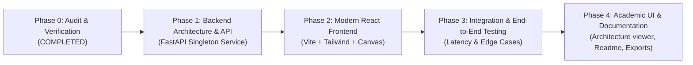

# DEVELOPMENT ROADMAP: SimpleHTR Full-Stack Suite

**Project:** SimpleHTR Deep Learning Academic / Portfolio Web Platform  
**Status:** Phase 0 Complete $\to$ Ready for Phase 1  

---

## Phase Progression Timeline

---

## Phase Breakdown

### Phase 0: Audit & Technical Verification (Completed)
- [x] Inspect full workspace directory tree.
- [x] Verify pretrained model weights presence (`snapshot-13`).
- [x] Solve Python 3.12 + TensorFlow 2.21 compatibility (`tf-keras`, `np.float` alias fix).
- [x] Run baseline inference on `data/word.png` and `data/line.png`.
- [x] Verify Node.js (`v24.15.0`) and npm (`11.12.1`) availability.
- [x] Generate audit documents (`PROJECT_AUDIT.md`, `MODEL_ANALYSIS.md`, `TECH_STACK.md`, `DEVELOPMENT_ROADMAP.md`).

---

### Phase 1: High-Performance Backend Service (Next)
- [ ] Create `backend/` directory structure.
- [ ] Implement `backend/service.py` with thread-safe singleton model wrapper and warm memory retention.
- [ ] Implement in-memory image preprocessor (accepting raw bytes / PIL / OpenCV directly without disk IO).
- [ ] Implement `backend/main.py` with FastAPI endpoints:
  - `GET /api/health`
  - `GET /api/model-info`
  - `GET /api/samples`
  - `POST /api/predict` (Supports both file upload and base64 canvas drawings).
- [ ] Add CORS support and custom exception handlers.
- [ ] Test API endpoints via automated curl/requests.

---

### Phase 2: Modern React Frontend Development
- [ ] Scaffold React 19 app using Vite inside `frontend/`.
- [ ] Configure Tailwind CSS and Lucide icons.
- [ ] Implement core UI components:
  - **Header / Hero Section:** Title, badges (TensorFlow, BiLSTM, CTC, FastAPI, React), project overview.
  - **Interactive Dual-Mode Input:**
    - *Upload Tab:* Drag-and-drop zone with image preview and sample preset gallery (1-click load).
    - *Canvas Tab:* Whiteboard drawing canvas with stroke width controls, clear, and undo buttons.
  - **Results Card:** Clean typography of recognized text, copy button, animated confidence score progress ring.
  - **Model Architecture Inspector:** Visual diagram of the 5-layer CNN, 2-layer BiLSTM, and CTC decoder with explanations.
  - **Prediction History Log:** Session list of tested images with export to CSV/JSON.

---

### Phase 3: Integration, Latency & Edge-Case Testing
- [ ] Connect React frontend with FastAPI backend via proxy / environment config.
- [ ] Test drawing handwriting of varying thickness and sizes.
- [ ] Test multi-word sentences and single words.
- [ ] Validate error handling (invalid images, corrupted files, blank canvas).
- [ ] Verify latency: confirm inference response time remains $< 100$ms.

---

### Phase 4: Production Packaging & Academic Showcase
- [ ] Add a one-command startup script (e.g., `start_project.bat` / `run.ps1`) to launch both backend and frontend concurrently.
- [ ] Update top-level documentation with architecture diagrams, API docs, screenshots, and mathematical formulas for academic presentation.
- [ ] Prepare portfolio summary for resume/presentation.
