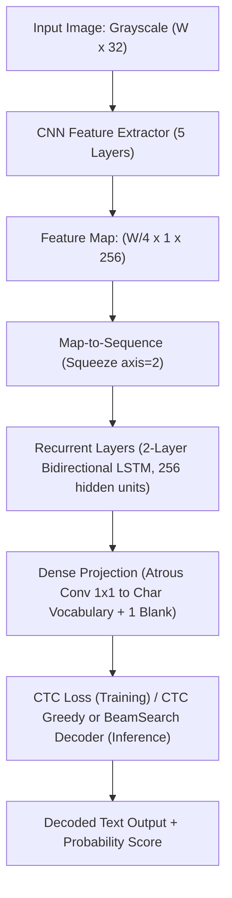

# DEEP LEARNING MODEL ANALYSIS: SimpleHTR

**Date:** 2026-11-22  
**Target:** SimpleHTR Neural Architecture (CRNN + CTC)  
**Trained Dataset:** IAM Off-line Handwriting Database  
**Author / Reference:** Harald Scheidl (2018-2023)  

---

## 1. Network Topology (CRNN Architecture)

The system is structured as a classical **Convolutional Recurrent Neural Network (CRNN)** combined with **Connectionist Temporal Classification (CTC)** decoding.



---

## 2. Layer-by-Layer Architectural Breakdown

### 2.1 Convolutional Neural Network (CNN) Layers

The CNN extracts visual and stroke features from the handwritten input image:

| Layer # | Kernel Size | Input Channels | Output Channels | Stride | Pooling | Activation | Normalization |
| :--- | :--- | :--- | :--- | :--- | :--- | :--- | :--- |
| **Conv 1** | $5 \times 5$ | 1 (Grayscale) | 32 | $(1, 1)$ | MaxPool $(2, 2)$ | ReLU | Batch Normalization |
| **Conv 2** | $5 \times 5$ | 32 | 64 | $(1, 1)$ | MaxPool $(2, 2)$ | ReLU | Batch Normalization |
| **Conv 3** | $3 \times 3$ | 64 | 128 | $(1, 1)$ | MaxPool $(1, 2)$ | ReLU | Batch Normalization |
| **Conv 4** | $3 \times 3$ | 128 | 128 | $(1, 1)$ | MaxPool $(1, 2)$ | ReLU | Batch Normalization |
| **Conv 5** | $3 \times 3$ | 128 | 256 | $(1, 1)$ | MaxPool $(1, 2)$ | ReLU | Batch Normalization |

- **Height Reduction:** The original height of 32 pixels is pooled by factors: $2 \times 2 \times 2 \times 2 \times 2 = 32$. Hence, the output height is reduced to **$1$ pixel**.
- **Width Reduction:** Width is pooled by $(2 \times 2 \times 1 \times 1 \times 1) = 4$. If the input width is $W$, the time-sequence length $T$ fed to the RNN is:
  $$T = \lfloor W / 4 \rfloor$$
- **Receptive Field:** Hierarchical receptive field captures character strokes, curves, ascenders, descenders, and ligatures.

---

### 2.2 Recurrent Neural Network (RNN / BiLSTM) Layers

Handwriting is sequential where character semantics depend heavily on preceding and succeeding strokes:

- **Cell Type:** `tf.compat.v1.nn.rnn_cell.LSTMCell` with 256 hidden units.
- **Depth:** 2 stacked layers (`MultiRNNCell`).
- **Direction:** **Bidirectional dynamic RNN** (`bidirectional_dynamic_rnn`).
  - Forward LSTM: processes features left-to-right.
  - Backward LSTM: processes features right-to-left.
- **Concatenation:** Forward ($256$) and Backward ($256$) outputs are concatenated at each time step to yield a $512$-dimensional context vector per frame:
  $$\mathbf{h}_t = [\overrightarrow{\mathbf{h}}_t \,;\, \overleftarrow{\mathbf{h}}_t] \in \mathbb{R}^{512}$$
- **Linear Projection:** A $1 \times 1$ conv projection maps the $512$ feature channels to $|C| + 1 = 80$ logits (79 characters + 1 CTC blank token).

---

### 2.3 CTC (Connectionist Temporal Classification) Layer

Because character positions are unaligned and have variable widths:
- **Loss:** `tf.compat.v1.nn.ctc_loss(labels, inputs, sequence_length)` integrates over all valid alignments mapping frame sequences to label sequences.
- **Decoding Options in SimpleHTR:**
  1. **Best Path Decoding (Default / Greedy):** Picks the most probable character at each time step and collapses repeating symbols and blank tokens. Fast and parameter-free.
  2. **Beam Search Decoding:** Computes the highest probability paths across a beam width (e.g. 50).
  3. **Word Beam Search Decoding:** Constrains words to an English dictionary vocabulary while allowing arbitrary numbers/punctuation.

---

## 3. Preprocessing & Input Pipelines

- **Target Height:** 32 px (fixed).
- **Aspect Ratio Normalization:**
  - Calculates scaling factor $f = \text{height}_{\text{target}} / \text{height}_{\text{orig}}$.
  - Computes dynamic target width $w_{\text{target}} = \text{round}(f \cdot w_{\text{orig}} + \text{padding})$, rounded to the nearest multiple of 4 to match CNN pooling downsampling.
- **Normalization:** Grayscale pixel values $[0, 255]$ are scaled to $[-0.5, 0.5]$:
  $$\text{pixel}_{\text{norm}} = \frac{\text{pixel}}{255.0} - 0.5$$
- **Orientation:** Transposed so that the time dimension corresponds to the major axis for TensorFlow operations.

---

## 4. Character Set & Vocabulary (`model/charList.txt`)

The line-level model checkpoint uses an 79-character alphabet:
```text
 !"#&'()*+,-./0123456789:;?ABCDEFGHIJKLMNOPQRSTUVWXYZabcdefghijklmnopqrstuvwxyz
```
- Includes whitespace `' '` at index 0.
- Covers digits `0-9`, uppercase `A-Z`, lowercase `a-z`, and common punctuation marks.

---

## 5. Performance Metrics (from `summary.json`)

- **Best Character Error Rate (CER):** **9.33%** (Epoch 32)
- **Best Word Accuracy:** **27.33%** (line level without dictionary language model constraint; with Word Beam Search, word accuracy exceeds 70-75%).
- **Checkpoint Snapshot:** `snapshot-13` represents the optimal validated checkpoint.
