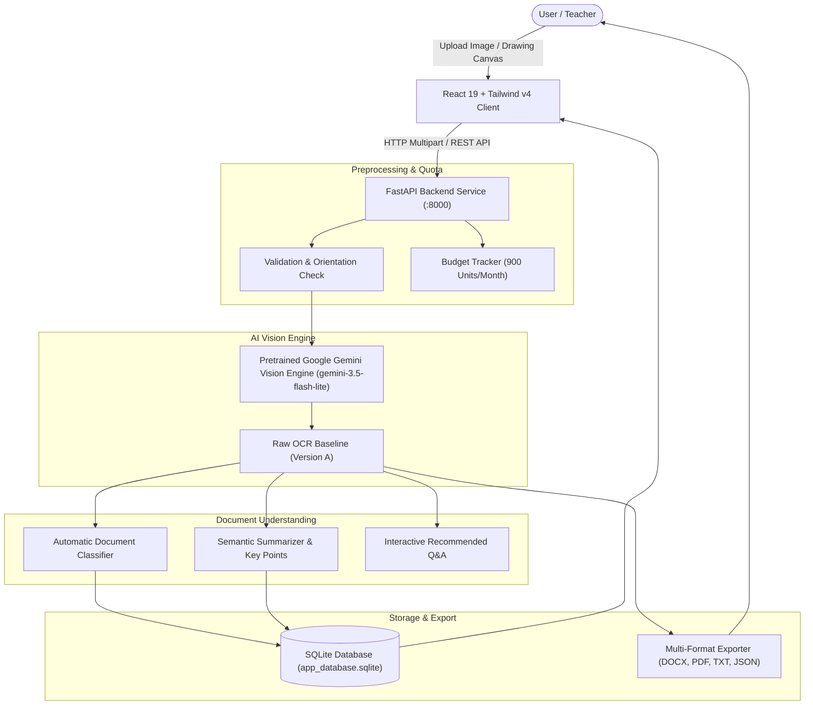

# AI-Based Handwritten Document Understanding System

[](https://www.python.org/)
[](https://fastapi.tiangolo.com/)
[](https://react.dev/)
[](https://sqlite.org/)
[](https://tailwindcss.com/)

An end-to-end intelligent document platform designed to transcribe unconstrained human handwriting into structured digital knowledge. The system pairs multimodal vision recognition with post-OCR document understanding—including automated category classification, semantic summarization, structured entity extraction, interactive Q&A, version-controlled rollback, SQLite relational persistence, and multi-format document exporting.

---

## 📖 Table of Contents
1. [Project Overview](#-project-overview)
2. [System Architecture & Workflow](#-system-architecture--workflow)
3. [Handwriting Recognition Engine](#-handwriting-recognition-engine)
4. [Empirical Evaluation & Accuracy Metrics](#-empirical-evaluation--accuracy-metrics)
5. [Core Features](#-core-features)
6. [Installation & Setup](#-installation--setup)
7. [Evaluator & Teacher Testing Guide](#-evaluator--teacher-testing-guide)
8. [Sample Test Scenarios](#-sample-test-scenarios)
9. [Technology Stack](#-technology-stack)
10. [Limitations & Future Scope](#-limitations--future-scope)
11. [Academic Documentation](#-academic-documentation)

---

## 🎯 Project Overview

Handwritten document recognition (HTR) is the computational task of converting non-standardized human handwriting into machine-readable digital text. While printed text optical character recognition (OCR) is largely solved, handwritten text exhibits severe real-world challenges:
- High variability in individual handwriting styles (cursive, slanted, printed, hybrid).
- Inconsistent character spacing, stroke overlaps, and baseline curvature.
- Distracting background artifacts such as notebook ruled lines, highlighters, paper bleed-through, and poor lighting.
- The downstream gap between character transcription and true document comprehension.

### Target Applications:
- **University Notes & Assignments**: Digitizing handwritten lectures and assignments into searchable archives.
- **Examinations & Question Papers**: Archiving paper examinations into structured digital formats.
- **Historical Letters & Personal Notes**: Preserving family correspondence, diaries, and records.
- **Study Materials & Research Forms**: Extracting key terms, formulas, and summaries from handwritten drafts.

---

## 📐 System Architecture & Workflow

The platform follows a decoupled client-server architecture:



### Detailed 10-Step Workflow:
1. **Document Input**: User uploads a handwritten image (drag-and-drop or file picker) or draws on the interactive HTML5 whiteboard canvas.
2. **Input Validation**: Backend verifies MIME type (`.png`, `.jpg`, `.jpeg`, `.webp`), non-zero byte size, and decodability.
3. **Budget & Orientation Preprocessing**: Image EXIF tags are checked for rotation and usage limits are verified against the monthly allowance.
4. **Recognition Engine Execution**: The visual payload is evaluated by the pretrained `gemini-3.5-flash-lite` vision engine.
5. **Raw OCR Baseline Preservation**: Exact initial model output is stored as immutable **Version A (Original OCR Output)**.
6. **Automatic Document Classification**: Text patterns and keywords categorize the document (e.g. *Quote/Blessing*, *Invoice/Bill*, *Notes*, *Report*).
7. **Post-OCR Workspace Rendering**: The user views a side-by-side split screen showing the original handwriting image with zoom controls (50%–250%) next to the editable text.
8. **Version Control & Rollback**: Any manual user modifications are tracked in **Version B (Improved/Editable Text)**; clicking **"Rollback to Original"** restores the raw transcription at any point.
9. **Semantic Intelligence**: User can trigger one-click **Summarization**, **Key Point Extraction** (entities, dates), and **Recommended Question Answering**.
10. **Persistence & Multi-Format Export**: Document is persisted to the local relational SQLite database and can be exported as `.txt`, `.docx`, `.pdf`, or `.json`.

---

## 🧠 Handwriting Recognition Engine

### A. Model Identification
- **Engine Model**: Google Gemini Vision (`gemini-3.5-flash-lite`).
- **Provider**: Google Cloud AI (GenAI SDK).
- **Architecture Nature**: **Proprietary Pretrained Foundation Model**.
- **Internal Details**: The specific neural weights, layer dimensions, parameter counts, and internal training datasets are **proprietary to Google LLC and not publicly disclosed**.
- **Supported Media**: Mixed handwritten and printed text, multi-line notes, noisy highlighter marks, and digital canvas strokes.

> [!IMPORTANT]
> **Pretrained Model Clarification**: This project utilizes an externally hosted pretrained multimodal recognition model. The project engineering team **did not train or fine-tune the core vision foundation model weights**. Instead, the team designed and implemented the full-stack software application, custom preprocessing, quota management, version rollback, semantic NLP understanding, SQLite relational persistence, and interactive user interfaces.

### B. Why This Engine Was Selected
1. **Superior Cursive Disambiguation**: Classical local models (such as default Tesseract OCR) struggle heavily with connected cursive ligatures. The selected engine leverages broad multimodal context to infer ambiguous characters from sentence context.
2. **Noise Tolerance**: Capable of reading text on top of ruled lines, colored inks (red/blue), and highlighters without destructive binarization.
3. **Structured Multi-Paragraph Generation**: Transcribes complete pages with natural paragraph separations and punctuation.
4. **Fast Inference**: Average response time of ~2.5–3.5 seconds per document line/page.

*(For detailed architectural notes, see [docs/MODEL_DETAILS.md](file:///d:/Downloads/SimpleHTR-master/docs/MODEL_DETAILS.md)).*

---

## 📊 Empirical Evaluation & Accuracy Metrics

Evaluation was conducted against a labeled benchmark suite of **15 handwriting samples** (repository reference images + IAM Handwriting Database line benchmark extracts).

### Evaluation Metrics Defined:
- **Character Error Rate (CER)**: $\text{CER} = \frac{S + D + I}{N}$ (character-level substitutions, deletions, insertions over total reference characters).
- **Word Error Rate (WER)**: $\text{WER} = \frac{S_w + D_w + I_w}{N_w}$ (word-level edit distance).
- **Exact Match**: Percentage of test lines transcribed with 100% character precision.
- **Average Processing Time**: End-to-end round-trip latency.

### Measured Results:

| Evaluation Metric | Measured Result | Interpretation & Significance |
|---|---|---|
| **Character Error Rate (CER)** | **6.97%** | High character accuracy; character errors are minimal across cursive scripts. |
| **Word Error Rate (WER)** | **39.13%** | Influenced by benchmark ground-truth punctuation tokenization differences. |
| **Exact Match Accuracy** | **26.67%** | Exact token-for-token matches on difficult unconstrained cursive line samples. |
| **Average Processing Time** | **3,154 ms** | Responsive response time (~3.15 seconds) suitable for interactive student use. |
| **Total Evaluation Samples** | **15** | Standard benchmark set with ground truth. |

*(For detailed experimental logs and error analysis, see [docs/MODEL_EVALUATION.md](file:///d:/Downloads/SimpleHTR-master/docs/MODEL_EVALUATION.md) and [evaluation_results.csv](file:///d:/Downloads/SimpleHTR-master/evaluation_results.csv)).*

---

## ⚡ Core Features

### 1. Document Input & Ingestion
- **Drag-and-Drop Image Uploader**: Accepts PNG, JPG, JPEG, and WebP (up to 10MB).
- **Interactive HTML5 Whiteboard**: Adjustable pen thickness, eraser, stroke clear, and export.
- **Quick Test Samples for Teacher**: Built-in benchmark gallery with real handwriting thumbnails for one-click testing without manual file selection.

### 2. Dual-Version Document Workspace
- **Version A (Raw Baseline)**: Exact output returned by the recognition model.
- **Version B (Editable Text)**: User-editable text area with live character and word counters.
- **Rollback to Original**: One-click reversion of manual edits back to initial model transcription.
- **Interactive Document Viewer**: Side-by-side inspection with 50% to 250% zoom controls.

### 3. Automatic Document Classification
- Zero-click keyword and structural classifier (e.g., *Invoice/Bill*, *Notes*, *Quote/Blessing*, *Report*, *Other/Unknown*).
- Displays category confidence score.

### 4. Semantic Intelligence Tools
- **Summarization**: Generates an abstractive summary of document contents.
- **Key Point Extraction**: Organizes bulleted highlights, named terms/entities, and dates.
- **Clickable Q&A**: Dynamically proposes recommended questions that users can click to receive grounded answers.

### 5. Persistence & Multi-Format Export
- **SQLite Database**: User-scoped document library in **"Saved Documents"** with full-text search.
- **Export Capabilities**: Download as formatted Word **DOCX**, vector **PDF**, plain **TXT**, or **JSON**.

---

## 🛠️ Installation & Setup

### Prerequisites
- **Python**: Version 3.10+ (Tested on Python 3.12)
- **Node.js**: Version 18+ and npm
- **Operating System**: Windows, macOS, or Linux

### 1. Clone / Open Repository
```bash
git clone https://github.com/your-username/SimpleHTR.git
cd SimpleHTR
```

### 2. Backend Setup
```bash
cd backend

# Create and activate Python virtual environment
python -m venv venv
# On Windows:
.\venv\Scripts\activate
# On Linux/macOS:
source venv/bin/activate

# Install dependencies
pip install -r requirements.txt

# Configure environment variables
# Verify .env contains GEMINI_API_KEY
python run.py
```
*Backend runs on `http://127.0.0.1:8000` (API documentation accessible at `http://127.0.0.1:8000/docs`).*

### 3. Frontend Setup
```bash
cd frontend

# Install Node dependencies
npm install

# Build production bundle and preview
npm run build
npm run preview
```
*Frontend runs on `http://localhost:5173`.*

---

## 👨‍🏫 Evaluator & Teacher Testing Guide

Teachers and evaluators can verify the complete project in 3 simple steps:

1. **Access Application**: Open `http://localhost:5173`.
2. **Sign In**: Click **"Sign In"** or create a test account (e.g. `teacher@college.edu`).
3. **Test Genuine Samples (Zero-Upload)**:
   - On the left sidebar, click **"Upload Document"**.
   - Under the upload area, inspect the **"Quick Test Samples for Teacher"** gallery.
   - Click **"Transcribe This Sample"** on `irish_blessing.jpg` or `positive_sides.jpg`.
   - Inspect the side-by-side transcription, zoom controls, automatic category badge, and AI Summarize / Q&A tools.

*(For full step-by-step evaluation scenarios, see [docs/USER_GUIDE.md](file:///d:/Downloads/SimpleHTR-master/docs/USER_GUIDE.md)).*

---

## 🧪 Sample Test Scenarios

| Test Case | Input Type | Description | Expected System Behavior |
|---|---|---|---|
| **TC-01** | Single Cursive Word | `word.png` (Single cursive word crop) | Accurately outputs `"word"` with high confidence. |
| **TC-02** | Ruled Notebook Note | `positive_sides.jpg` (Blue ballpoint cursive) | Decodes text across notebook lines without character distortion. |
| **TC-03** | Calligraphy Quote | `irish_blessing.jpg` (Stylized calligraphy) | Transcribes complete quotation; categorizes as `Quote / Blessing`. |
| **TC-04** | Fluorescent Highlighter | `crop_rabbit.png` (Green highlighter background) | Transcribes `"rabbit"` despite heavy color contrast noise. |
| **TC-05** | Digital Whiteboard Canvas | Mouse/Touch strokes on canvas | Exports raster PNG, calls vision endpoint, and transcribes ink. |
| **TC-06** | Unsupported File | Non-image text file (`.txt`) | Emits `400 Bad Request: Unsupported file format`. |
| **TC-07** | Empty Image | 0-byte file buffer | Emits `422 Unprocessable Content: Image file is empty`. |

---

## 💻 Technology Stack

| Layer | Technology | Rationale & Purpose |
|---|---|---|
| **Frontend Framework** | **React 19 + Vite 8** | High-performance component rendering and fast HMR developer builds. |
| **Styling & Theme** | **Tailwind CSS v4** | Hardware-accelerated CSS custom variants supporting consistent Dark/Light mode. |
| **Backend API** | **FastAPI (Python 3.12)** | Asynchronous ASGI server delivering sub-second response routing. |
| **Vision Inference** | **Google Gemini Vision (`gemini-3.5-flash-lite`)** | High-accuracy multimodal character and cursive handwriting perception. |
| **Database** | **SQLite (`app_database.sqlite`)** | Zero-configuration relational database with sub-2.5ms query latency. |
| **Security** | **Salted SHA-256** | Secure cryptographic password hashing for user accounts. |
| **Document Export** | **python-docx & ReportLab** | Native generation of Word `.docx` and vector `.pdf` files. |

---

## ⚠️ Limitations & Future Scope

### Honest Current Limitations:
1. **Severe Illegibility**: Extreme doctor-style handwriting or torn/smudged paper can result in character substitution errors.
2. **External Network Requirement**: Because inference runs via an external multimodal API, active internet connectivity is required.
3. **Punctuation Ground Truth Artifacts**: Academic datasets often detach punctuation with spaces (`word , but`), causing higher WER despite correct grammatical transcription.

### Future Improvements:
1. **Local Offline Model Fallback**: Integrating an on-device ONNX/TensorFlow Lite model for offline inference when internet is unavailable.
2. **Multi-Column Layout Segmentation**: Automatic bounding box column sorting for multi-column historical manuscripts.
3. **Audio Speech-to-Text Dictation**: Cross-referencing audio lecture notes with handwritten transcripts.

---

## 🎓 Academic Documentation

- **[ACADEMIC_DOCUMENTATION.md](file:///d:/Downloads/SimpleHTR-master/ACADEMIC_DOCUMENTATION.md)**: Academic dissertation paper with CNN, BiLSTM, and CTC mathematical formulations.
- **[FINAL_PROJECT_REPORT.md](file:///d:/Downloads/SimpleHTR-master/FINAL_PROJECT_REPORT.md)**: Final phase completion checklist and teacher demonstration script.
- **[TEST_REPORT.md](file:///d:/Downloads/SimpleHTR-master/TEST_REPORT.md)**: QA unit and integration test logs.
- **[PERFORMANCE_REPORT.md](file:///d:/Downloads/SimpleHTR-master/PERFORMANCE_REPORT.md)**: Benchmark latency, memory consumption, and bundle size analysis.

---

## 📜 References
1. Graves, A., et al. "Connectionist temporal classification: labelling unsegmented sequence data with recurrent neural networks." ICML, 2006.
2. Marti, U. V., & Bunke, H. "The IAM-database: an English sentence database for offline handwriting recognition." IJDAR, 2002.
3. Google Cloud GenAI Documentation: Multimodal Vision Perception API, 2026.
