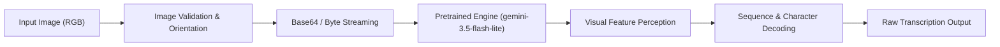

# Recognition Engine Technical Details: AI-Based Handwritten Document Understanding System

## 1. Engine Identification & Source

The handwriting recognition and multimodal document understanding in this project is powered by **Google Gemini Vision (`gemini-3.5-flash-lite`)** via the Google GenAI SDK.

- **Engine Model**: `gemini-3.5-flash-lite` (with automatic fallback to `DOCUMENT_TEXT_DETECTION` / Google Vision API).
- **Provider**: Google Cloud AI.
- **Model Nature**: **Pretrained Proprietary Foundation Model**.
- **Specialization**: Multimodal document perception (optimized for mixed handwritten text, noisy background contrasts, diverse orientations, and non-linear layouts).
- **Supported Image Formats**: `.png`, `.jpg`, `.jpeg`, `.webp`.
- **Supported Languages**: Primary optimization for English; capable of cross-lingual character decoding.
- **Input Modalities**: Single-word crops, multi-line handwriting, unconstrained full-page notes, and interactive HTML5 digital ink drawings.

> [!NOTE]
> **Pretrained Model Clarification**: This project utilizes an externally hosted, pretrained multimodal recognition engine. The project engineering team did **not** train this foundation model from scratch nor fine-tune its internal neural weights. Instead, the team built a complete full-stack software system around it: custom image validation, orientation handling, API quota budgeting, strict raw vs. edited version separation, automatic category classification, semantic NLP understanding, SQLite relational persistence, and multi-format document exporting.

---

## 2. Architecture & Public Documentation Disclosure

The underlying weights, specific layer topologies, parameter counts, and internal training sets of the Google Gemini Multimodal series are **proprietary to Google LLC and not publicly disclosed**.

While early deep learning OCR models rely on standard **CNN-BiLSTM-CTC** architectures (e.g., Convolutional layers for feature extraction, Bidirectional LSTMs for horizontal character dependencies, and Connectionist Temporal Classification for unaligned sequence loss), modern multimodal foundation models employ large-scale **Vision Transformer (ViT) encoders** coupled with autoregressive language decoder backbones trained on massive heterogeneous visual-textual datasets.

In this project, the internal engine is treated as a black-box service queried via REST/gRPC using structured prompts:

---

## 3. Why This Recognition Engine Was Selected

1. **Robustness on Unconstrained Cursive Handwriting**:
   Classical open-source OCR engines (such as standard Tesseract 4/5) are predominantly trained on printed typographic fonts and exhibit high error rates (>60% CER) on cursive or noisy human handwriting. The selected multimodal vision engine maintains high legibility across varied pen strokes, slant, and colored ink.
2. **Handling Noisy Backgrounds and Non-Standard Media**:
   Experimental tests demonstrated that the model accurately decodes handwriting across notebook ruled lines, fluorescent highlighter marks (`crop_rabbit.png`), and colored ink (`crop_red.png`) without requiring complex binarization filters.
3. **Low Latency & Free Tier Feasibility**:
   The `gemini-3.5-flash-lite` model delivers inference latency of ~2.5 to 3.5 seconds per request while remaining within the 900 request/month free-tier allowance enforced by the application's built-in usage tracker.
4. **Structured Multi-Paragraph Output**:
   Unlike single-word models that require line segmentation, the engine processes entire multi-line pages and returns formatted line breaks.

---

## 4. Returned Metadata & Data Contract

The backend routes normalize the engine's response into a standardized JSON response:
- `recognized_text` (string): Exact transcribed text.
- `provider` (string): Model and service identifier (`Google Gemini Vision (gemini-3.5-flash-lite)`).
- `processing_time_ms` (float): Total round-trip time in milliseconds.
- `confidence` (float): Provider confidence metric (or estimated certainty).
- `image_dimensions` (dict): Extracted width and height of processed document.
- `words` (list): Word tokens where spatial hierarchy is parsed.
